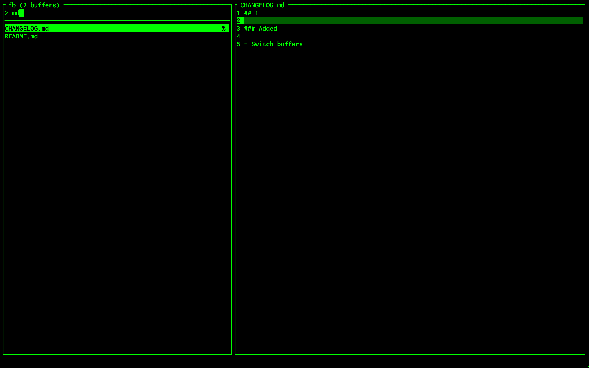

# fb.vim

A full-screen buffer switcher for Vim



Why use fb.vim?

- **Speed** — Vim9 script that compiles into bytecode and the code is autoloaded: it costs nothing at startup until the first `:Fb`.
- **Focus** — One prompt, one list, one preview. No fuzzy scoring or ranking to second-guess: the query is a literal substring and the buffers are in the order you used them.
- **Simplicity** — Clone the repo. No package manager, no configuration, no dependencies.

## Requirements

- [Vim](https://github.com/vim/vim) 9.0+

## Install

Just clone the repository:
```sh
git clone https://github.com/Solver42/fb.vim ~/.vim/pack/plugins/start/fb.vim
```

## Update

```sh
cd ~/.vim/pack/plugins/start/fb.vim && git pull
```

## Usage

- **:Fb** opens the switcher
- **:Fb {text}** opens it with an initial query
- **Type** to filter, **Backspace** or **Ctrl+H** to delete
- **Ctrl+N**, **Ctrl+J** or **Down** select next buffer **Ctrl+P**, **Ctrl+K** or **Up** select previous buffer
- **Ctrl+D** or **Ctrl+F** scroll preview down **Ctrl+B** or **Ctrl+U** scroll preview up
- **Enter** or **Ctrl+Y** switch to the buffer
- **Esc** or **Ctrl+C** close

## How it works

The left pane lists the buffers that `:ls` shows, the right pane shows a preview of the highlighted buffer.

The query is a literal substring of the buffer's name, which is its path as `:ls` shows it. It is smart-case: case-insensitive unless the query contains an uppercase letter.

Buffers are listed most recently used first: the buffer you are in, then the alternate buffer (the one `Ctrl+^` goes to), then the rest. The buffer you are in is never preselected unless it is the only match, so `:Fb` and then Enter takes you to the alternate buffer. The flags on the right are the ones from `:ls`: `%` the buffer you are in, `#` the alternate buffer, `+` unsaved changes. Only the first 500 buffers are listed, and the title shows the total.

The preview shows 200 lines around the line your cursor was on in that buffer, with that line highlighted, so it opens where the buffer would. It is read from memory, so unsaved changes show. A buffer that is not loaded is read from its file instead: binary files, files that can't be read and files over 2 MB are not read, and the preview says so.

Enter runs `:buffer`, so the usual rules apply: with `nohidden` and unsaved changes in the current buffer Vim refuses to leave it, and the error is shown.

## Configuration

You can change the order of the buffers, `'mru'` (most recently used, the default), `'path'` or `'number'` (the order of `:ls`):

```
let g:fb_sort = 'path'
```

You can change how many buffers are listed:

```
let g:fb_max_buffers = 1000
```

You can change how many lines the preview shows:

```
let g:fb_preview_lines = 100
```

You can change the size in bytes above which files that are not loaded are not previewed:

```
let g:fb_max_size = 1048576
```

To open the switcher with a key, map it in `.vimrc`:

```
nnoremap <silent> <Leader>b :Fb<CR>
```
